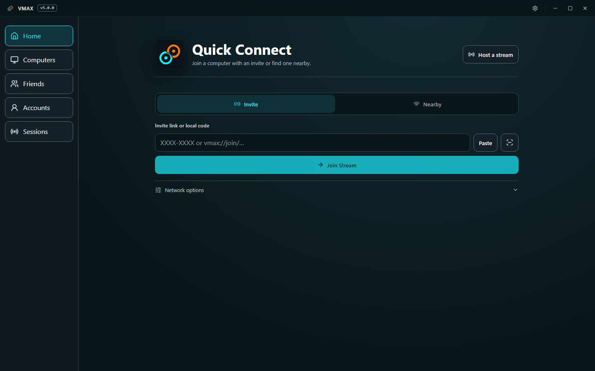
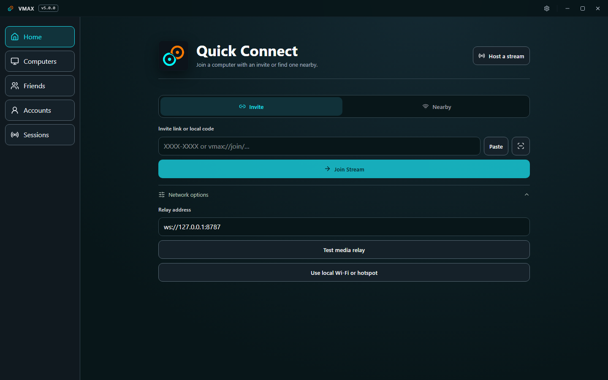
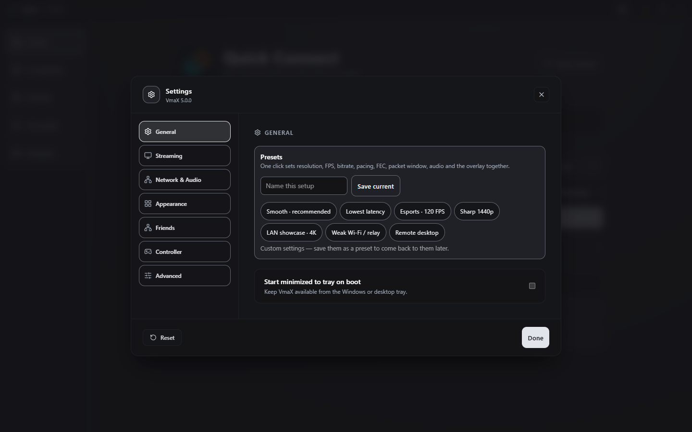

# VmaX

**Ultra-low-latency peer-to-peer remote desktop and game streaming for Windows and Android.**

VmaX connects a **host** (the machine being streamed) to a **client** over a direct
QUIC/UDP path when possible, and automatically falls back to an authenticated relay.
Certificates are pinned with a SHA-256 fingerprint exchanged over the signaling
channel, so neither side trusts an unverified peer.



## Features

- **Low-latency transport** — QUIC over UDP with NAT traversal, relay fallback,
  path migration and BBR-style congestion control.
- **Hardware video** — H.264/HEVC encoding through NVENC or Media Foundation,
  D3D11 decode, NV12 shader presentation and cursor compositing.
- **Audio** — Opus with adaptive jitter buffering and device-level capture.
- **Input** — remote keyboard, mouse and gamepad, plus an Android remote-keyboard
  plugin and immersive full-screen streaming.
- **Sessions** — invite links, 8-character codes, QR codes, LAN presence
  discovery, saved computers and per-guest permissions.
- **Accounts** — optional Supabase-backed identity, friends, presence and
  device access control.

## Screenshots

| Quick Connect | Network options |
| --- | --- |
|  |  |

| Streaming settings | Settings presets |
| --- | --- |
|  |  |

## Downloads

Build outputs are published on the [Releases](../../releases) page:

| File | Platform |
| --- | --- |
| `VmaX.exe` | Windows 10/11 (portable) |
| `VmaX-Setup.exe` | Windows installer (NSIS) |
| `VmaX-Android-arm64.apk` | Android 8.0+ (arm64-v8a) |

The Windows build is self-contained. The installer bundles the WebView2
bootstrapper and the Visual C++ redistributable. The APK is signed for
sideloading.

## Repository layout

| Path | Purpose |
| --- | --- |
| `src/` | React + TypeScript frontend |
| `src-tauri/` | Rust backend (Tauri v2), capture, encode, transport |
| `src-tauri/windows/` | NSIS installer script and prerequisites |
| `src-tauri/shaders/` | HLSL shaders for NV12/CAS presentation |
| `docs/screenshots/` | Screenshots used in this README |
| `tools/` | Asset generation helpers |
| `build_vmax_release.ps1` | Windows + installer + Android build driver |
| `setup_android_env.ps1` | Android SDK/JDK/NDK environment setup |

## Building

### Windows

Requirements:

- Rust stable, `x86_64-pc-windows-msvc` target
- Node.js 20+
- Visual Studio 2022 Build Tools with the **Desktop development with C++** workload
- Windows 10/11 SDK
- NSIS (only for the installer)

```powershell
npm install
powershell -NoProfile -ExecutionPolicy Bypass -File .\build_vmax_release.ps1
```

Outputs at the repository root:

- `VmaX.exe` — portable executable
- `VmaX-Setup.exe` — NSIS installer

### Android

Requirements:

- Android SDK (platform 34, build-tools 34+) and NDK
- JDK 17+
- Rust target `aarch64-linux-android`

```powershell
powershell -NoProfile -ExecutionPolicy Bypass -File .\setup_android_env.ps1
powershell -NoProfile -ExecutionPolicy Bypass -File .\build_vmax_release.ps1 -SkipWindows -SkipInstaller
```

Output: `VmaX-Android-arm64.apk`

> On Windows without Developer Mode, Tauri cannot create the jniLibs symlink, so
> the build script copies the compiled `libvmax_lib.so` into the Gradle project
> before packaging.

## Development

```powershell
npm install
npm run tauri dev
```

The Vite dev server listens on <http://localhost:1420>, matching `devUrl` in
`src-tauri/tauri.conf.json`.

## Tests

```powershell
cd src-tauri
cargo test --lib
```

## Fixes in 5.0.0

- Installed the rustls `ring` crypto provider exactly once at startup, fixing the
  crash on the first TLS/signaling connection (both `ring` and `aws-lc-rs` are
  enabled transitively, so rustls could not infer a provider).
- Registered the `set_remote_keyboard` and `set_stream_immersive` commands with
  the Tauri handler so Android remote input and immersive streaming work.
- Aligned the Vite dev server with the Tauri `devUrl` (port 1420).
- Removed duplicated theme variables and duplicated tracing initialization.
- Bundled the VmaX logo into the UI and fixed the settings modal header/footer
  layout.

## License

Proprietary. All rights reserved.
