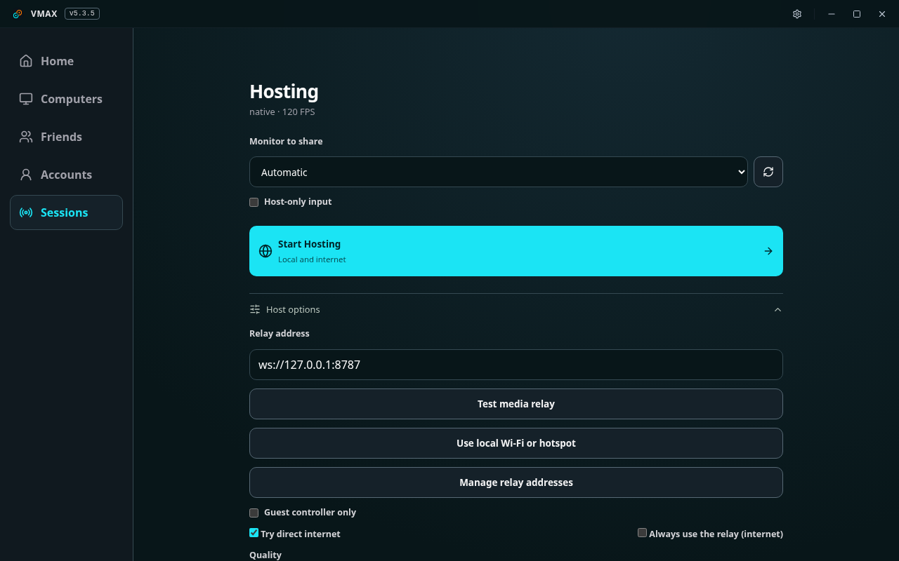
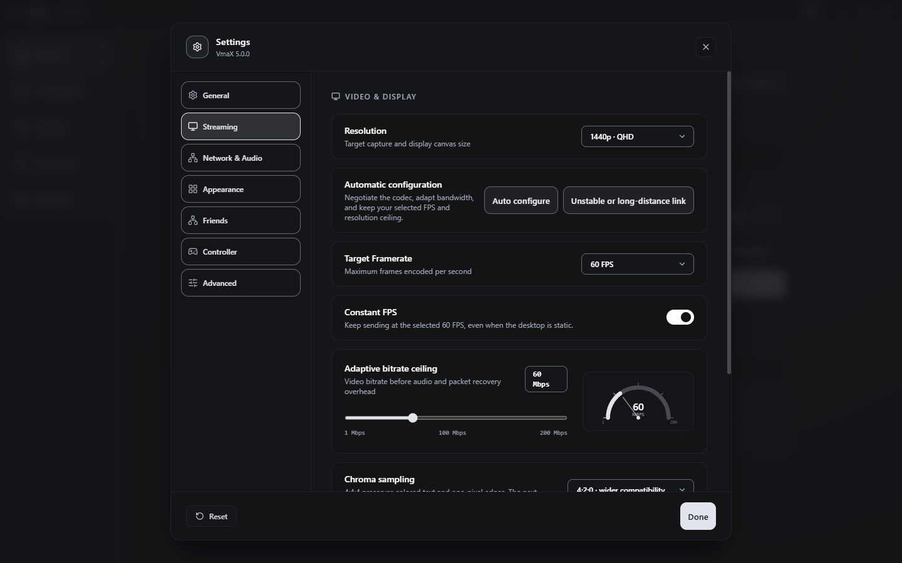

<p align="center">
  
</p>

<h1 align="center">VmaX</h1>

<p align="center"><strong>Ultra-low-latency peer-to-peer remote desktop and game streaming for Windows and Android.</strong></p>

VmaX connects a **host** (the machine being streamed) to a **client** over a direct
QUIC/UDP path when possible, and automatically falls back to an authenticated relay.
Certificates are pinned with a SHA-256 fingerprint exchanged over the signaling
channel, so neither side trusts an unverified peer.


## Features

- **Low-latency transport** — QUIC over UDP with NAT traversal, relay fallback,
  path migration and BBR-style congestion control.
- **Hardware video** — H.264/HEVC encoding through NVENC or Media Foundation,
  D3D11 decode, NV12 shader presentation and cursor compositing.
- **Audio** — Opus with adaptive jitter buffering and device-level capture.
- **Input** — remote keyboard, mouse and gamepad, plus an Android remote-keyboard
  plugin and immersive full-screen streaming.
- **Sessions** — invite links, 8-character codes, QR codes, LAN presence
  discovery, saved computers and per-guest permissions.
- **Accounts** — optional Supabase-backed identity, friends, presence and
  device access control.

## Screenshots

| Quick Connect | Hosting a session |
| --- | --- |
|  |  |

| Network options | Streaming settings |
| --- | --- |
|  |  |

## Downloads

Build outputs are published on the [Releases](../../releases) page:

| File | Platform |
| --- | --- |
| `VmaX.exe` | Windows 10/11 (portable) |
| `VmaX-Setup.exe` | Windows installer (NSIS) |
| `VmaX-Android-arm64.apk` | Android 8.0+ (arm64-v8a) |

The Windows build is self-contained. The installer bundles the WebView2
bootstrapper and the Visual C++ redistributable. The APK is signed for
sideloading.

## Repository layout

| Path | Purpose |
| --- | --- |
| `src/` | React + TypeScript frontend |
| `src-tauri/` | Rust backend (Tauri v2), capture, encode, transport |
| `src-tauri/windows/` | NSIS installer script and prerequisites |
| `src-tauri/shaders/` | HLSL shaders for NV12/CAS presentation |
| `docs/screenshots/` | Screenshots used in this README |
| `tools/` | Asset generation helpers |
| `build_vmax_release.ps1` | Windows + installer + Android build driver |
| `setup_android_env.ps1` | Android SDK/JDK/NDK environment setup |

## Building

### Windows

Requirements:

- Rust stable, `x86_64-pc-windows-msvc` target
- Node.js 20+
- Visual Studio 2022 Build Tools with the **Desktop development with C++** workload
- Windows 10/11 SDK
- NSIS (only for the installer)

```powershell
npm install
powershell -NoProfile -ExecutionPolicy Bypass -File .\build_vmax_release.ps1
```

Outputs at the repository root:

- `VmaX.exe` — portable executable
- `VmaX-Setup.exe` — NSIS installer

### Android

Requirements:

- Android SDK (platform 34, build-tools 34+) and NDK
- JDK 17+
- Rust target `aarch64-linux-android`

```powershell
powershell -NoProfile -ExecutionPolicy Bypass -File .\setup_android_env.ps1
powershell -NoProfile -ExecutionPolicy Bypass -File .\build_vmax_release.ps1 -SkipWindows -SkipInstaller
```

Output: `VmaX-Android-arm64.apk`

> On Windows without Developer Mode, Tauri cannot create the jniLibs symlink, so
> the build script copies the compiled `libvmax_lib.so` into the Gradle project
> before packaging.

## Internet relay

VmaX prefers a direct QUIC path when the peers can establish one. For internet
hosting, the Windows app can automatically select from configured VmaX
WebSocket relays. It verifies bidirectional packet forwarding and ranks the
working relays by the median of three packet round trips measured from the
host. This is a host-side comparison, so it does not predict the viewer's
network path or capture-to-display latency.

### Optional TURN over UDP

With a VmaX 5.3.4 or later viewer and signaling server, a compatible Windows
host can use an authenticated IPv4 TURN allocation. To configure automatic
credentials on a host with Cloudflare Realtime TURN support, create a TURN key
in the Cloudflare dashboard and set
`VMAX_CLOUDFLARE_TURN_KEY_ID` and `VMAX_CLOUDFLARE_TURN_API_TOKEN` in the
host application's launch environment. The host requests temporary credentials
and uses the first advertised UDP endpoint that successfully allocates a relay.
Keep the scoped API token private and configure it only on the hosting machine.

For another provider or a fallback when Cloudflare is unavailable, set:

- `VMAX_TURN_SERVER` — UDP TURN endpoint as `hostname:port`, such as
  `turn.cloudflare.com:3478`.
- `VMAX_TURN_USERNAME` and `VMAX_TURN_PASSWORD` — TURN client credentials
  issued by your provider. Use scoped, short-lived credentials when available.

The viewer does not need those credentials. VmaX verifies the UDP route with
authenticated packets before switching traffic to it. Direct UDP takes
priority, and WebSocket forwarding remains available when UDP is blocked
or the TURN allocation is unavailable. Update self-hosted signaling servers
so they can pass TURN addresses in session setup. Endpoint availability,
bandwidth charges and latency depend on the operator and network.

### Self-host a WebSocket signaling relay

To run a relay on a machine near your players:

```sh
cargo build --manifest-path relay-server/Cargo.toml --release --locked
VMAX_RELAY_PORT=8787 ./relay-server/target/release/vmax-relay
```

The relay listens on loopback. Put a TLS reverse proxy with WebSocket support
in front of it. For example, use this Caddy configuration with your own DNS name:

```caddyfile
relay.example.com {
    reverse_proxy 127.0.0.1:8787
}
```

Run one instance per region and add the resulting `wss://` URLs in Network
options or as a comma-separated `VMAX_PUBLIC_RELAY_URLS` value on the Windows
host. Use a regional DNS name for each instance so both peers reach the same
relay when using an invite. The relay software has no usage fee. Infrastructure
and bandwidth depend on your hosting provider.

## Development

```powershell
npm install
npm run tauri dev
```

The Vite dev server listens on <http://localhost:1420>, matching `devUrl` in
`src-tauri/tauri.conf.json`.

## Tests

```powershell
cd src-tauri
cargo test --lib
```

## Fixes in 5.1.0

- **Native 120 FPS gaming baseline** — Default preset now captures at the host's own display resolution ("Native") at a constant 120 FPS with a 60 Mbps adaptive ceiling. Congestion control trades bitrate before latency.
- **New "Native" resolution option** — Keeps the host's exact display size (up to 8K); the encoder never upscales.
- **One-frame repair window** — Jitter buffer reduced from 32 ms to 16 ms (one frame at 120 Hz).
- **Stronger reconstruction sharpening** — Host sharpening 30 → viewer sharpening 55 for readable HUD text through 4:2:0.
- **192 kbps Opus audio** — Up from 128 kbps for clearer voice and game audio.
- **Windows power-throttling opt-out** — Disables EcoQoS so capture/encode threads keep full priority when window loses focus.
- **Longer hole-punch budget** — Removed 1.5 s WAN cap; direct NAT traversal gets the full configured timeout.
- **WebView2 background timer throttling disabled** — Keeps decode/present loop responsive.
- **Duplicated LAN preset ID fixed** — Presets are now `native`, `lan`, `latency`, `esports`, and `showcase`.
- Installed the rustls `ring` crypto provider exactly once at startup, fixing the
  crash on the first TLS/signaling connection (both `ring` and `aws-lc-rs` are
  enabled transitively, so rustls could not infer a provider).
- Registered the `set_remote_keyboard` and `set_stream_immersive` commands with
  the Tauri handler so Android remote input and immersive streaming work.
- Aligned the Vite dev server with the Tauri `devUrl` (port 1420).
- Removed duplicated theme variables and duplicated tracing initialization.
- Bundled the VmaX logo into the UI and fixed the settings modal header/footer
  layout.

## License

Proprietary. All rights reserved.
