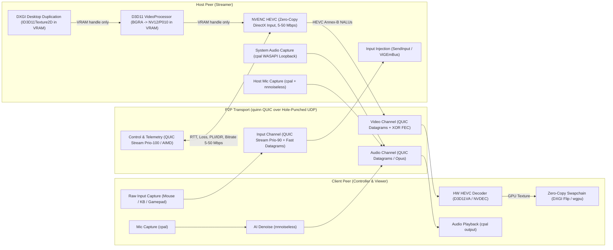
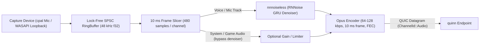
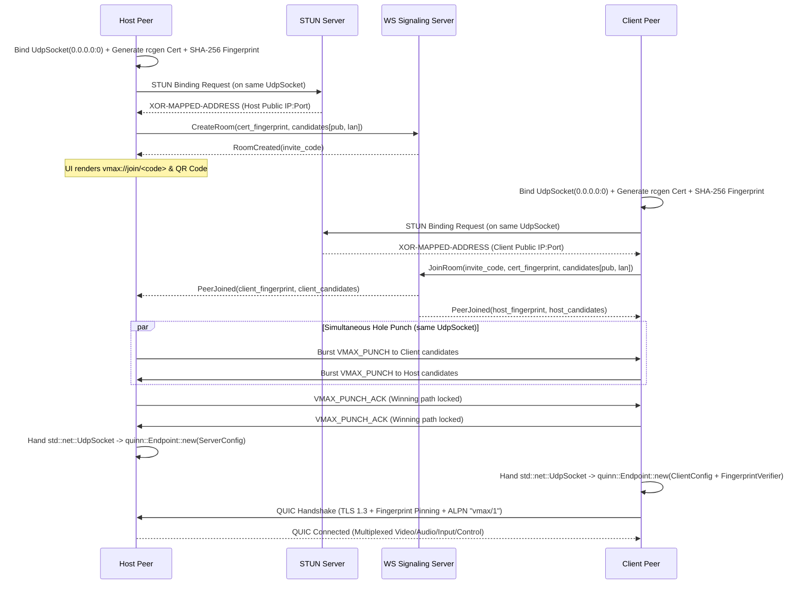

# VmaX Architecture Specification

**VmaX** is an open-source, ultra-low-latency peer-to-peer (P2P) remote desktop and game streaming system designed for up to **4K (3840×2160) @ 60 Hz** video with **< 15 ms internal glass-to-glass latency**, built-in AI audio noise suppression, and zero-configuration P2P invite links / QR codes.

---

## 1. Latency Budget (Target: < 15 ms Internal at 4K 60 Hz)

At 60 Hz, one frame interval is `16.67 ms`. To prevent pipeline queuing and maintain crisp interactive responsiveness, VmaX operates strictly with **single-frame depth (zero frame-buffering queues)** on both capture/encode and decode/present paths.

| Stage | Subsystem | Target Budget | Design Mechanism |
| :--- | :--- | :--- | :--- |
| **Input Capture** | Client OS / Window Hook | **0.2 – 0.5 ms** | Raw Input (`WM_INPUT`) / pointer deltas coalesced only per tick |
| **Input Transport** | QUIC Priority Lane | **0.5 ms** (+ ½ RTT) | Priority-90 reliable stream (keys/clicks) + datagram fast-lane (mouse Δ) |
| **Input Injection** | Host Win32 / Virtual Pad | **0.3 ms** | `SendInput` + ViGEmBus kernel virtual gamepad |
| **Frame Capture** | Windows DXGI DDA | **0.8 – 1.5 ms** | `IDXGIOutputDuplication::AcquireNextFrame` (0 ms timeout / event-driven) |
| **Encode (Zero-Copy)** | NVIDIA NVENC HEVC | **2.5 – 4.0 ms** | Direct D3D11 VRAM resource registration (`P1/P2`, Ultra-Low-Latency, 0 B-frames) |
| **Packetize + FEC** | Rust Network Engine | **0.3 – 0.6 ms** | MTU-aligned QUIC datagrams + inline XOR parity shard (`10:1` default) |
| **Transport / Wire** | `quinn` QUIC (UDP) | *Network RTT/2* | BBR pacing, zero Head-of-Line blocking, shared STUN hole-punched socket |
| **Reassembly + FEC** | Rust Network Engine | **0.2 – 0.5 ms** | Jitter-bounded frame assembly (16 ms deadline), immediate single-loss XOR recovery |
| **Decode (Zero-Copy)** | D3D11VA / NVDEC HEVC | **2.5 – 4.0 ms** | Direct GPU hardware bitstream decode to NV12/P010 `ID3D11Texture2D` |
| **Display Present** | DXGI Flip Swapchain | **0.5 – 1.5 ms** | `DXGI_SWAP_EFFECT_FLIP_DISCARD` + `WAITABLE_OBJECT` / `wgpu` surface |
| **Total Internal** | *Excluding network RTT* | **~7.8 – 12.9 ms** | **Meets < 15 ms internal latency target** |

---

## 2. End-to-End Data Flow



### Stage-by-Stage Walkthrough

#### Stage A: Input (`Client -> Network -> Host`)
1. **Capture (Client):** Client intercepts keyboard scan codes, mouse button states, wheel ticks, and high-frequency (up to 1000 Hz) relative mouse deltas when the stream viewport has pointer lock.
2. **Transport:**
   - **Discrete state events** (key down/up, mouse down/up, gamepad buttons) travel on a dedicated **reliable, ordered QUIC unidirectional stream** configured with `SendStream::set_priority(90)`. Because QUIC streams are independent, video packet loss never stalls input delivery, and reliable delivery ensures a key-up event is never dropped.
   - **High-frequency relative mouse motion** (`MouseMoveRel { dx, dy }`) can use either the priority-90 stream or unreliable QUIC datagrams (`ChannelId::Input`) for minimal tail latency.
3. **Injection (Host):** Host deserializes `InputPacket`, timestamps arrival for latency telemetry, and injects events immediately via Win32 `SendInput` (or `ViGEmBus` for virtual XInput gamepads).

#### Stage B: Capture (`Host VRAM`)
1. **DXGI Desktop Duplication:** Host acquires an `IDXGIOutputDuplication` interface on the primary adapter/output sharing the NVIDIA RTX GPU's `ID3D11Device`.
2. **Zero-Copy Frame Acquisition:** Calling `AcquireNextFrame(16, &frame_info, &desktop_resource)` yields an `IDXGIResource` backed by an `ID3D11Texture2D` residing strictly in **GPU VRAM**.
3. **No CPU Readback Rule:** VmaX **never** creates a `D3D11_USAGE_STAGING` texture and **never** calls `CopyResource` to system RAM or `Map()` on raw RGBA pixels. Dirty/move rectangles (`GetFrameDirtyRects` / `GetFrameMoveRects`) are forwarded as optional motion/ROI hints.

#### Stage C: Encode (`Host VRAM -> Bitstream`)
1. **On-GPU Color Space Conversion:** If the desktop surface is `DXGI_FORMAT_B8G8R8A8_UNORM` (or `R10G10B10A2_UNORM` for 10-bit HDR) and NVENC prefers `NV12` / `P010`, an `ID3D11VideoProcessor` (`VideoProcessorBlt`) converts the surface **in-place within VRAM** to a ring of 2–3 GPU-resident `ID3D11Texture2D` NV12 surfaces.
2. **NVENC Zero-Copy Registration:**
   - `NvEncRegisterResource` registers the D3D11 `ID3D11Texture2D` directly using `NV_ENC_INPUT_RESOURCE_TYPE_DIRECTX`.
   - `NvEncMapInputResource` maps the GPU texture for the active encode frame.
   - Encoder preset: **HEVC (H.265)**, `NV_ENC_TUNING_INFO_ULTRA_LOW_LATENCY`, `P1`/`P2` preset, `frameIntervalP = 1` (IPPP… zero B-frame reordering delay), `enableIntraRefresh` or instant IDR on PLI, `repeatSPSPPS = 1`.
3. **Bitstream Extraction:** Only the compressed HEVC Annex-B bitstream (`~20 KB – 250 KB` per frame vs `~33 MB` raw 4K RGBA) is copied from the NVENC output bitstream buffer (`NvEncLockBitstream`) into a pooled Rust `Bytes` buffer.
4. **Dynamic Bitrate Reconfiguration:** When the congestion controller updates target bitrate (`5 Mbps – 50 Mbps`), Host calls `NvEncReconfigureEncoder` with updated `averageBitRate` and `maxBitRate` (`VBV buffer = 1 frame` for strict latency bounds) without tearing down the session or forcing a jarring IDR spike.

#### Stage D: Network (`Host <-> Client`)
1. **Signaling & NAT Traversal:** Both peers connect via WebSocket to the signaling server, bind a single `std::net::UdpSocket` (`0.0.0.0:0`), run RFC 5389 STUN Binding to learn their public reflexive `IP:port`, exchange candidates + ephemeral X.509 certificate SHA-256 fingerprints, simultaneously burst `VMAX_PUNCH` packets on that **exact same socket**, and hand the socket handle directly to `quinn::Endpoint::new`.
2. **Multiplexed Channels over One QUIC Association:**
   - **Video (`ChannelId::Video = 0x01`, QUIC Unreliable Datagrams):** Compressed HEVC access units are sliced into MTU-safe chunks (`<= max_datagram_size - header`, typically `~1160 B` payload). Each group of `k` data chunks (e.g., `k = 10`) emits 1 inline **XOR FEC parity chunk**.
   - **Audio (`ChannelId::Audio = 0x02`, QUIC Unreliable Datagrams):** 10 ms or 20 ms Opus packets fit comfortably inside a single QUIC datagram (`~80 – 320 B`), ensuring sub-ms audio transport unaffected by video frame bursts.
   - **Input (`ChannelId::Input = 0x03`, Reliable Stream Prio-90 + Fast Datagram):** Guaranteed delivery for key/button transitions and ultra-fast delivery for pointer deltas.
   - **Control (`ChannelId::Control = 0x04`, Reliable Stream Prio-100):** Session negotiation, RTT echo (`Ping`/`Pong`), `TelemetryFeedback`, `BitrateUpdate`, and `RequestKeyframe` (PLI).

#### Stage E: Decode & Display (`Client VRAM`)
1. **Frame Reassembly & FEC:** `VideoReassembler` collects chunks keyed by `frame_id`. If 1 chunk in a `k`-chunk FEC group is lost, the missing chunk is algebraically reconstructed via XOR in `< 50 µs` without waiting a round-trip. If a frame suffers unrecoverable multi-packet loss and exceeds its jitter deadline (`16 ms`), it is discarded immediately (zero HoL blocking) and a `ControlMessage::RequestKeyframe` (PLI) is transmitted upstream.
2. **Hardware HEVC Decode:** Complete Annex-B access units are fed directly to `D3D11VA` (`ID3D11VideoDecoder`) or `NVDEC` (`cuvidParseVideoData` + `cuvidDecodePicture`), decoding straight into GPU VRAM (`ID3D11Texture2D` NV12/P010).
3. **Zero-Copy Presentation:** The decoded GPU surface is bound directly as a shader resource / video processor input into a flip-model `IDXGISwapChain3` (`DXGI_SWAP_EFFECT_FLIP_DISCARD`, `FRAME_LATENCY_WAITABLE_OBJECT` with maximum frame latency = 1) or shared `wgpu` texture, presenting on the client monitor with `SyncInterval = 0` (tearing/low-latency) or `1` (VSync).

---

## 3. Audio Capture & AI Noise Suppression Pipeline



- **Why separate Mic vs. System Audio paths?** Applying RNNoise (`nnnoiseless`) aggressively to background music or game sound effects treats explosion transients and synths as "noise" and degrades game OST fidelity. VmaX applies `nnnoiseless` (48 kHz, 480-sample 10 ms frames) specifically to voice/microphone capture (and optionally to desktop audio when toggled for voice-call remote desktop), preserving full-range game audio while giving Discord-grade voice clarity.

---

## 4. P2P Signaling, STUN & QUIC Hole-Punching Sequence



### Security Model (Zero-Trust P2P without Public CAs)
- Every session generates a fresh ephemeral X.509 certificate (`rcgen`) in memory.
- The certificate's **SHA-256 DER fingerprint** is exchanged inside the signaling handshake (and can be pinned directly in the `vmax://join/...` URI fragment).
- `FingerprintCertVerifier` implements `rustls::client::danger::ServerCertVerifier` to cryptographically verify both TLS 1.3 handshake signatures and exact SHA-256 certificate equality—preventing MITM spoofing even over untrusted networks without requiring a central CA.

---

## 5. Dynamic Bandwidth Management (`5 Mbps – 50 Mbps`)

Located in `src-tauri/src/bitrate.rs`, `BitrateController` runs on a **200 ms control loop** combining QUIC path telemetry (`quinn::ConnectionStats::path`) with receiver-reported frame health (`TelemetryFeedback`):

1. **Inputs Sampled Every 200 ms:**
   - `rtt_ms` and `min_rtt_ms` (queuing delay `delta_rtt = rtt_ms - min_rtt_ms`)
   - Interval packet loss ratio (`delta_lost / delta_sent`)
   - QUIC `congestion_events` delta
   - Receiver `fec_recovered_frames`, `dropped_frames`, and decode queue depth
2. **Control Law (AIMD + Delay Gradient):**
   - **Severe Congestion** (`loss > 3%` OR `queuing_delay > 18 ms` OR receiver frame drops > 2/interval):
     - Multiplicative decrease: `target = max(5 Mbps, target * 0.75)`
     - Enters short hold-down window (`600 ms`) to let queues drain.
   - **Moderate Congestion** (`loss 1%..3%` OR `queuing_delay 8..18 ms` OR new QUIC congestion event):
     - Gentle backoff: `target = max(5 Mbps, target * 0.90)`
   - **Healthy Path** (`loss < 0.5%` AND `queuing_delay < 5 ms` AND `0` frame drops):
     - Additive ramp-up: `+2.0 Mbps` (when `< 15 Mbps`) or `+1.25 Mbps` (when `>= 15 Mbps`), capped at `min(50 Mbps, user_max_bitrate)`.
3. **NVENC Hysteresis:** Encoder reconfiguration events are emitted only when bitrate shifts by `>= 5%` (`>= 500 kbps`) to avoid frequent rate-control resets.

---

## 6. UI/UX Design System & Tailwind Grayscale Tokens

VmaX enforces an **ultra-minimalist, deep dark grayscale** aesthetic designed to eliminate visual fatigue during low-latency streaming sessions. Saturated primary colors are strictly prohibited; hierarchy is expressed purely through luminance contrast, borders, typography, and monochrome data visualization.

### 6.1 Color & Surface Tokens

| Token Role | Tailwind Class | Hex Value | Usage |
| :--- | :--- | :--- | :--- |
| **Canvas Background** | `bg-zinc-950` | `#09090b` | Root viewport background, recessed graph wells |
| **Elevated Surface** | `bg-zinc-900` | `#18181b` | Primary cards, telemetry panels, modal surfaces |
| **Interactive Surface** | `bg-zinc-800` | `#27272a` | Secondary buttons, segmented tabs, hover states, progress tracks |
| **Border Hairline** | `border-zinc-800` / `border-zinc-700` | `#27272a` / `#3f3f46` | 1 px structural dividers and card framing |
| **Muted Label** | `text-zinc-500` | `#71717a` | Micro-captions, units, inactive icons |
| **Body / Telemetry** | `text-zinc-300` | `#d4d4d8` | Standard text, secondary telemetry, chart gridlines |
| **Primary Highlight** | `text-white` / `bg-white text-zinc-950` | `#ffffff` | Active numerals, SVG graph stroke, speedometer needle, primary CTA |
| **QR Frame** | `bg-white` (`fg=#09090b`) | `#ffffff` / `#09090b` | High-contrast scannable QR surface |

### 6.2 Layout & Visual Telemetry Rules
- **Spacing:** Wide container margins (`px-8 py-8`, `max-w-7xl`), generous internal card padding (`p-6` / `p-7`), and spacious grid gutters (`gap-6` / `gap-8`).
- **Visuals over Text:** Avoid descriptive paragraphs. Surface state through:
  - **Ping Live Area Graph:** Monochrome SVG sparkline (`#ffffff` stroke over subtle `zinc-800` baseline) displaying rolling RTT history (`ms`) and jitter.
  - **Bitrate Speedometer:** Semicircular SVG radial gauge spanning `5–50 Mbps` with tick marks and dynamic arc fill.
  - **Internal Latency & FPS Readout:** High-contrast tabular numerals (`tabular-nums`) for `FPS` (`60`), internal pipeline latency (`< 15 ms`), and resolution (`4K`).
  - **Hardware Telemetry Bars:** Minimal horizontal meter tracks (`bg-zinc-800` track, `bg-white` / `bg-zinc-300` fill) for GPU / NVENC, VRAM, CPU, and RNNoise audio DSP load.

### 6.3 Engineering Quality Constraints
- **Rust Zero-Unwrap Policy:** Production code (`#![cfg_attr(not(test), deny(clippy::unwrap_used, clippy::expect_used))]`) avoids `.unwrap()` and `.expect()`, propagating all failures cleanly via typed `thiserror` `Result`s and `?`.
- **Strict TypeScript:** `"strict": true` with zero `any` types across all components, hooks, and Tauri IPC bindings.

### 6.4 In-Stream Overlay & Touch Gamepad
- **Overlay:** A single compact pill (zinc-950/75, hairline zinc-700 border, mono tabular numerals) shows `ping · Mbps · fps` at the top center. Tapping it drops a narrow vertical panel (`min(21rem, 100vw − 1.5rem)`, max `64 dvh`, scrollable) with the full telemetry grid — ping, video bitrate, FPS drawn, decode latency, transport, TX loss, and the live decoded resolution — plus stacked controls (gaming, keyboard, FPS lock, window/fullscreen, settings, disconnect). The pill auto-fades to 30% opacity after four idle seconds and wakes on any pointer activity; in gaming mode it hides entirely and a thin top-edge strip re-summons the panel. When stats are disabled, the pill collapses to a bare `…` glyph.
- **Touch Gamepad:** Mirrors a physical Xbox layout — triggers/bumpers above their sides, left stick above the D-pad, face buttons above the right stick, View/Menu centered in-flow (grid, no absolute overlap). Controls use `touch-action: none`, `pointer-events: auto`, 44 px+ hit targets (`clamp(36px, 10.5vw, 50px)`), and safe-area insets.

---

## 7. Repository Module Layout

```text
VmaX/
├── VmaX_Architecture.md          # This architecture specification & design tokens
├── package.json                  # Tauri v2 + React 19 + TypeScript + Tailwind v4
├── src/
│   ├── App.tsx                   # Minimalist monochrome dashboard shell
│   ├── types.ts                  # Strictly typed telemetry & IPC contracts (no `any`)
│   └── components/
│       ├── VmaXLogo.tsx          # Minimalist geometric SVG brand mark
│       ├── PingGraph.tsx         # Live monochrome SVG ping/jitter sparkline
│       ├── BitrateGauge.tsx      # 5-50 Mbps semicircular SVG speedometer
│       └── HardwareStats.tsx     # NVENC / GPU / VRAM / CPU / RNNoise meters
└── src-tauri/
    ├── Cargo.toml                # Rust manifest (quinn, rustls, rcgen, tokio-tungstenite)
    └── src/
        ├── lib.rs                # Tauri app builder & zero-unwrap runtime gate
        ├── commands.rs           # Tauri IPC commands & telemetry event bridge
        ├── protocol.rs           # Binary packet headers, XOR FEC packetizer & VideoReassembler
        ├── stun.rs               # Pure-Rust RFC 5389 STUN client & local candidate gatherer
        ├── signaling.rs          # WebSocket signaling client, invite parser, LAN presence discovery & local relay
        ├── bitrate.rs            # 5-50 Mbps AIMD/delay-gradient bandwidth controller
        ├── network.rs            # Core P2P UDP hole-punch + quinn QUIC multiplexed event loop
        ├── capture/              # [Phase 2] DXGI Desktop Duplication + NVENC zero-copy
        └── audio/                # [Phase 3] cpal capture + nnnoiseless RNNoise + Opus
```

---

## 8. Phased Implementation Plan

1. **Phase 1 (Current):** `VmaX_Architecture.md`, Tauri + React + Tailwind v4 grayscale UI shell (with `VmaXLogo`, `lucide-react` icons, Invite/QR generator, live-animated visual telemetry dashboard) + strict zero-unwrap Rust network foundation (`network.rs`, `protocol.rs`, `stun.rs`, `signaling.rs`, `bitrate.rs`).
2. **Phase 2 (Pending Visual Approval):** Windows DXGI Desktop Duplication (`ID3D11Texture2D`) + NVIDIA NVENC HEVC zero-copy encoder pipeline.
3. **Phase 3:** `cpal` audio capture + `nnnoiseless` RNNoise real-time denoising + Opus transport.
4. **Phase 4:** Client-side hardware HEVC decoder (`D3D11VA` / `NVDEC`), flip-model swapchain renderer, and Win32/ViGEmBus input injection.
